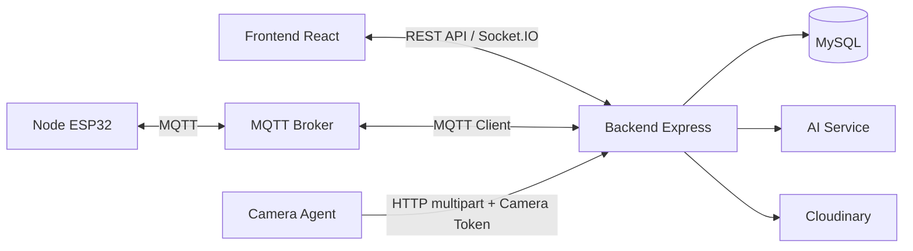

# SERVER DESIGN — SMART AGRICULTURE IoT

---

## 1. Mục tiêu và nguyên tắc thiết kế

Server là trung tâm điều phối hệ thống Smart Agriculture IoT. Server tiếp nhận dữ liệu từ Node ESP32 và Camera, quản lý thiết bị, xử lý cấu hình/lệnh điều khiển, lưu lịch sử cảm biến, nhận kết quả AI, quản lý danh mục bệnh và cung cấp dữ liệu cho Frontend.

Các nguyên tắc thiết kế chính:

1. **Backend là nơi thực thi quyền hạn.** Frontend chỉ ẩn/hiện thao tác theo vai trò; mọi thao tác ghi dữ liệu đều được kiểm tra lại tại Backend.
2. **MQTT dành cho luồng IoT.** Telemetry, heartbeat, trạng thái, cấu hình, lệnh và ACK đi qua MQTT.
3. **HTTP dành cho quản trị và Camera.** Frontend gọi REST API; Camera gửi ảnh qua HTTP multipart với Camera token.
4. **AI Analysis tách biệt Disease/Treatment.** Kết quả AI chỉ lưu và hiển thị thông tin nhận diện. Danh mục bệnh và phương pháp điều trị được quản lý ở một phân hệ riêng.
5. **Một bệnh có nhiều phương pháp điều trị.** Mỗi Treatment bắt buộc thuộc về đúng một Disease.
6. **Không có phân hệ Deficiency.** Hệ thống không quản lý thiếu dinh dưỡng/thiếu chất; Treatment chỉ liên kết với Disease.
7. **Lịch sử AI được bảo toàn.** Không cho xóa bệnh nếu bệnh đã được sử dụng trong các kết quả AI.

## 2. Kiến trúc tổng quan



### 2.1. Các thành phần

| Thành phần | Vai trò |
|---|---|
| Frontend | Dashboard, quản lý thiết bị/Node/Camera, cấu hình, cảnh báo, kết quả AI, danh mục bệnh và phương pháp điều trị |
| Backend | REST API, authentication, RBAC, nghiệp vụ, MQTT client, Camera API, tích hợp AI, Socket.IO |
| MySQL | Lưu người dùng, thiết bị, telemetry, commands, alerts, ảnh/kết quả AI, danh mục Disease/Treatment và audit log |
| MQTT Broker | Trung chuyển dữ liệu và lệnh hai chiều giữa Backend với Node ESP32 |
| Node ESP32 | Gửi heartbeat/telemetry/trạng thái, nhận lệnh và cấu hình, phản hồi ACK |
| Camera Agent | Heartbeat, nhận lệnh chụp, gửi ảnh và metadata bằng HTTP |
| AI Service | Phân tích ảnh, trả nhãn bệnh, confidence và các lớp dự đoán |
| Cloudinary | Lưu ảnh gốc do Camera gửi lên; Backend lưu URL và public ID trong MySQL |
| Socket.IO | Đẩy sự kiện mới/cập nhật tới giao diện đang mở |

## 3. Công nghệ và cấu trúc Backend

### 3.1. Công nghệ

- Node.js và Express.js: HTTP API và middleware.
- Sequelize: ORM, model và association.
- MySQL: cơ sở dữ liệu quan hệ.
- MQTT.js: kết nối MQTT Broker.
- Socket.IO: cập nhật dữ liệu gần thời gian thực.
- JWT: xác thực phiên người dùng.
- bcryptjs: băm mật khẩu.
- Multer: nhận ảnh multipart từ Camera.
- Cloudinary SDK: upload và xóa ảnh.

### 3.2. Phân lớp Backend

| Lớp | Trách nhiệm |
|---|---|
| `routes/` | Khai báo endpoint, authentication và phân quyền theo vai trò |
| `controllers/` | Nhận request, kiểm tra tham số ở mức HTTP và trả response |
| `services/` | Nghiệp vụ chính: MQTT ingest, command, Camera lifecycle, AI, Cloudinary, alert, audit |
| `models/` | Định nghĩa bảng và quan hệ Sequelize |
| `middlewares/` | JWT, Camera token, RBAC, upload ảnh và xử lý lỗi |
| `config/` | Kết nối MySQL, MQTT, TLS và cấu hình runtime |
| `utils/` | API error, pagination, async wrapper và helper |

Controller không nên chứa toàn bộ nghiệp vụ MQTT/AI. Các xử lý có nhiều bước hoặc cần tái sử dụng được đặt trong `services/`.

## 4. Các phân hệ nghiệp vụ

### 4.1. Authentication và User

- Người dùng đăng nhập bằng username/password.
- Backend xác minh mật khẩu, phát hành JWT và cung cấp thông tin người dùng hiện tại.
- User có ba vai trò: `admin`, `operator`, `viewer`.
- Chỉ Admin được quản lý tài khoản và phân quyền thiết bị.

### 4.2. Node và Device

- Node đại diện cho bộ điều khiển ESP32.
- Một Node có thể quản lý nhiều Device.
- Device bao gồm thiết bị cảm biến/chấp hành và Camera theo loại được hỗ trợ trong model.
- Node có mã định danh và thông tin MQTT riêng; quy trình claim/provisioning được thực hiện qua Backend.
- Device có vòng đời như `REGISTERED`, `PROVISIONED`, `ACTIVE`, `FAULT`, `MAINTENANCE`, `DECOMMISSIONED`.
- Trạng thái kết nối của Node được theo dõi riêng với vòng đời Device.

### 4.3. Telemetry và Dashboard

- Node gửi telemetry, heartbeat và trạng thái tới MQTT Broker.
- MQTT Client của Backend nhận bản tin, phân tích topic/payload và chuyển cho `ingest.service`.
- Backend xác thực Node, kiểm tra dữ liệu, ghi SensorReading và cập nhật trạng thái thiết bị.
- Dashboard đọc dữ liệu tổng hợp, số liệu cảm biến mới nhất, cảnh báo và kết quả AI gần đây.

### 4.4. Điều khiển và cấu hình thiết bị

- Frontend gửi yêu cầu điều khiển/cấu hình đến REST API.
- Backend kiểm tra quyền, quyền sở hữu/phạm vi thiết bị, trạng thái thiết bị và tính hợp lệ của payload.
- Backend tạo DeviceCommand hoặc phiên bản cấu hình, publish MQTT tới Node tương ứng.
- Node thực thi và gửi ACK.
- Backend cập nhật trạng thái lệnh/cấu hình; các lệnh quá hạn được đánh dấu timeout và xử lý theo chính sách hiện có.
- Admin và Operator có thể điều khiển/cấu hình trong phạm vi quyền; Viewer chỉ xem.

### 4.5. Camera

Camera được quản lý như một thiết bị riêng, có credential/token riêng và vòng đời hoạt động.

Các chức năng chính:

- Admin đăng ký Camera và cấp/thu hồi Camera token.
- Camera gửi heartbeat để Backend cập nhật trạng thái.
- Frontend có thể yêu cầu Camera chụp ngay; Camera Agent nhận lệnh qua polling và gửi ACK.
- Camera gửi ảnh và metadata qua `POST /api/camera/media` bằng multipart/form-data và Bearer Camera token.
- Backend kiểm tra token, trạng thái Camera, eventId, loại ảnh và kích thước file.
- Nếu AI/Cloudinary được bật, Backend gọi AI trước, upload **ảnh gốc** lên Cloudinary, sau đó lưu kết quả AI và URL ảnh trong MySQL.
- Nếu pipeline AI không được bật, Backend lưu media vào kho local theo chế độ dự phòng hiện có.

### 4.6. AI Analysis — chỉ lưu và hiển thị kết quả

Phân hệ AI Analysis không có chức năng CRUD bệnh hoặc CRUD phương pháp điều trị.

Kết quả phân tích được tạo từ luồng Camera HTTP:

1. Camera gửi ảnh và `eventId`.
2. Backend gọi AI Service bằng buffer ảnh nhận được.
3. AI trả về nhãn bệnh, tên hiển thị, confidence, predictions và thông tin thời gian/model.
4. Backend ánh xạ nhãn AI vào Disease thông qua `modelLabel` (có hỗ trợ đối chiếu tên bệnh theo logic hiện tại).
5. Backend upload ảnh gốc lên Cloudinary.
6. Backend lưu dữ liệu vào `leafAnalyses`, liên kết với `diseaseId` và `deviceId` Camera.
7. Backend phát sự kiện `analysis:new` qua Socket.IO.
8. Frontend hiển thị danh sách và chi tiết kết quả nhận diện.

**Dữ liệu AI Analysis gồm:**

- Thời gian nhận diện (`capturedAt`).
- Camera/Device nguồn (`deviceId`, nếu có).
- Disease được ánh xạ (`diseaseId`).
- Confidence.
- Predictions của các lớp AI.
- AI result gốc đã chuẩn hóa.
- Model version và inference time.
- Ảnh (`imageUrl`, Cloudinary public ID hoặc `imagePath` cũ nếu có).
- Event ID và SHA-256 để chống nhận trùng/đối chiếu dữ liệu.

Màn hình AI Chẩn Đoán chỉ hiển thị lịch sử, ảnh và kết quả nhận diện. Không đặt thao tác thêm/sửa/xóa bệnh, không đặt CRUD phương pháp điều trị và không nhúng `recommendations` vào response chi tiết AI.

### 4.7. Disease Catalog và Treatment Management

Đây là phân hệ độc lập để quản lý kiến thức về bệnh và cách điều trị.

**Giao diện Frontend:**

- Mục menu **Danh Mục Bệnh**.
- Bên trái: danh sách bệnh, tên, nhãn AI và số phương pháp điều trị.
- Khi chọn một bệnh: hiển thị thông tin bệnh và toàn bộ phương pháp điều trị của bệnh đó.
- Admin có thể thêm/sửa/xóa bệnh.
- Admin có thể thêm/sửa/xóa từng phương pháp điều trị trong bệnh đang chọn.
- Operator/Viewer có thể xem danh mục nhưng không có quyền chỉnh sửa.
- Nhãn lá khỏe mạnh (`isHealthy = true`) không có phương pháp điều trị.

**Quan hệ dữ liệu:**

```mermaid
erDiagram
    DISEASE ||--o{ TREATMENT : has
    DISEASE ||--o{ LEAF_ANALYSIS : identified_as
    DISEASE {
      int id PK
      string modelLabel UK
      string nameVi
      string nameEn
      boolean isHealthy
    }
    TREATMENT {
      int id PK
      int diseaseId FK
      string name
      enum type
      text instructions
      string activeIngredient
      string dosageText
      int intervalDays
      text sourceReference
    }
    LEAF_ANALYSIS {
      int id PK
      int diseaseId FK
      int deviceId FK
      datetime capturedAt
      decimal confidence
      json predictions
      json aiResult
      string imageUrl
      string cloudinaryPublicId
      string imageSha256
    }
```



**Quy tắc nghiệp vụ Disease:**

- `modelLabel` là khóa ánh xạ nhãn model AI và phải duy nhất.
- `nameVi` là tên bệnh hiển thị chính; `nameEn` có thể để trống.
- `isHealthy` xác định nhãn khỏe mạnh, không phải bệnh cần điều trị.
- Không được xóa Disease nếu đang được một hoặc nhiều LeafAnalysis tham chiếu.
- Không được xóa Disease khi vẫn còn Treatment thuộc Disease đó. Admin cần xóa các Treatment trước.

**Quy tắc nghiệp vụ Treatment:**

- Mỗi Treatment bắt buộc có đúng một `diseaseId` hợp lệ.
- Một Disease có thể có 0, 1 hoặc nhiều Treatment.
- `name` là tên phương pháp để người dùng nhận biết.
- `type` hiện gồm `BIOLOGICAL` (sinh học) và `CHEMICAL` (hóa học).
- `instructions` là hướng dẫn áp dụng.
- `activeIngredient` bắt buộc đối với phương pháp `CHEMICAL`.
- `dosageText`, `intervalDays` có thể để trống; nếu có `intervalDays` thì phải là số nguyên dương.
- `sourceReference` lưu tài liệu/nguồn tham khảo và bắt buộc.
- Không cho thêm Treatment cho Disease được đánh dấu là lá khỏe mạnh.

**Tách biệt AI và Treatment:**

`LeafAnalysis` chỉ tham chiếu Disease để hiển thị tên bệnh được nhận diện. Không có quan hệ `LeafAnalysis -> Treatment`; frontend không lấy danh sách điều trị từ kết quả AI. Khi muốn xem cách xử lý bệnh, người dùng chuyển sang màn hình Danh Mục Bệnh và chọn bệnh tương ứng.

## 5. API Design

Các endpoint dưới đây được mount dưới prefix `/api`.

### 5.1. Authentication và User

| Method | Endpoint | Mục đích |
|---|---|---|
| POST | `/auth/login` | Đăng nhập |
| GET | `/auth/me` | Lấy người dùng hiện tại |
| POST | `/auth/change-password` | Đổi mật khẩu |
| GET/POST | `/users` | Danh sách / tạo User (Admin) |
| GET/PATCH/DELETE | `/users/:id` | Xem / sửa / khóa User (Admin) |
| PUT | `/users/:id/devices` | Gán thiết bị cho User (Admin) |

### 5.2. Node và Device

| Method | Endpoint | Mục đích |
|---|---|---|
| GET/POST | `/nodes` | Danh sách / tạo Node (Admin) |
| GET/PATCH | `/nodes/:id` | Xem / sửa Node (Admin) |
| POST | `/nodes/:id/revoke` | Thu hồi Node (Admin) |
| POST | `/nodes/:id/restore` | Khôi phục Node (Admin) |
| POST | `/nodes/:id/mqtt-credentials` | Cấp lại MQTT credential (Admin) |
| POST | `/nodes/:id/claim-token` | Cấp lại claim token (Admin) |
| POST | `/nodes/:id/claim-reconcile` | Đồng bộ trạng thái claim (Admin) |
| POST | `/provisioning/claim` | Node claim bằng token |
| GET/POST | `/devices` | Danh sách / tạo Device |
| GET/PATCH | `/devices/:id` | Xem / sửa Device |
| POST | `/devices/:id/commands` | Gửi lệnh điều khiển |
| PATCH | `/devices/:id/config` | Cập nhật cấu hình |
| POST | `/devices/:id/lifecycle` | Chuyển vòng đời Device |
| GET | `/devices/:id/readings` | Lịch sử cảm biến theo Device |
| GET | `/devices/:id/commands` | Lịch sử lệnh theo Device |
| GET | `/readings/latest` | Dữ liệu cảm biến mới nhất |

### 5.3. Camera

| Method | Endpoint | Mục đích |
|---|---|---|
| GET | `/camera` | Danh sách Camera theo phạm vi truy cập |
| POST | `/camera` | Đăng ký Camera (Admin) |
| GET | `/camera/server-hints` | Thông tin Server cho Agent (Admin) |
| POST | `/camera/tokens/:cameraId` | Cấp Camera token (Admin) |
| DELETE | `/camera/tokens/:cameraId` | Thu hồi Camera token (Admin) |
| POST | `/camera/heartbeat` | Camera Agent gửi heartbeat |
| POST | `/camera/media` | Camera Agent gửi ảnh và metadata |
| POST | `/camera/commands/poll` | Camera Agent nhận lệnh chụp |
| POST | `/camera/commands/:requestId/ack` | Camera Agent phản hồi lệnh |
| PATCH | `/camera/:cameraId/config` | Cập nhật cấu hình Camera (Admin) |
| POST | `/camera/:cameraId/capture` | Yêu cầu chụp ngay |
| GET | `/camera/:cameraId/commands/:requestId` | Xem trạng thái lệnh |
| GET | `/camera/media` | Danh sách media local dự phòng |
| GET | `/camera/media/:eventId/file` | Tải media local |
| DELETE | `/camera/media/:eventId` | Xóa media local (Admin) |

### 5.4. AI Analysis — read-only

| Method | Endpoint | Mục đích |
|---|---|---|
| GET | `/analyses` | Danh sách kết quả nhận diện |
| GET | `/analyses/:id` | Chi tiết kết quả nhận diện |
| GET | `/analyses/:id/image` | Lấy ảnh có kiểm tra JWT và quyền truy cập |

Không cung cấp endpoint CRUD Treatment trong `/analyses`. Việc tạo kết quả AI diễn ra trong pipeline Camera HTTP; màn hình AI chỉ tiêu thụ API đọc.

### 5.5. Disease và Treatment

Tất cả endpoint yêu cầu JWT. GET cho mọi người dùng đã đăng nhập; POST/PATCH/DELETE chỉ dành cho Admin.

| Method | Endpoint | Mục đích |
|---|---|---|
| GET | `/diseases` | Danh sách bệnh kèm các phương pháp điều trị |
| GET | `/diseases/:id` | Chi tiết một bệnh và các phương pháp điều trị |
| POST | `/diseases` | Tạo bệnh (Admin) |
| PATCH | `/diseases/:id` | Sửa bệnh (Admin) |
| DELETE | `/diseases/:id` | Xóa bệnh nếu không được tham chiếu (Admin) |
| GET | `/treatments?diseaseId=:id` | Lọc phương pháp theo bệnh |
| GET | `/treatments/:id` | Chi tiết phương pháp điều trị |
| POST | `/treatments` | Tạo phương pháp (Admin) |
| PATCH | `/treatments/:id` | Sửa phương pháp (Admin) |
| DELETE | `/treatments/:id` | Xóa phương pháp (Admin) |

Ví dụ tạo Treatment:

```json
{
  "diseaseId": 1,
  "name": "Vệ sinh và loại bỏ lá bệnh",
  "type": "BIOLOGICAL",
  "instructions": "Cắt bỏ lá bị bệnh, thu gom và tiêu hủy đúng cách; vệ sinh dụng cụ sau khi thao tác.",
  "activeIngredient": null,
  "dosageText": null,
  "intervalDays": null,
  "sourceReference": "Tài liệu khuyến nông / URL tham khảo"
}
```

### 5.6. Dashboard, Alert và Audit

| Method | Endpoint | Mục đích |
|---|---|---|
| GET | `/dashboard/summary` | Dữ liệu tổng quan Dashboard |
| GET | `/dashboard/telemetry` | Dữ liệu telemetry phục vụ Dashboard |
| GET | `/alerts` | Danh sách cảnh báo |
| GET | `/alerts/:id` | Chi tiết cảnh báo |
| POST | `/alerts/:id/acknowledge` | Xác nhận cảnh báo (Admin/Operator) |
| POST | `/alerts/:id/resolve` | Xử lý cảnh báo (Admin/Operator) |
| GET | `/audit-logs` | Nhật ký thao tác (Admin) |

## 6. MQTT Design

Topic prefix của Firmware được cấu hình trong Backend; mặc định hiện tại là `sf`.

### 6.1. Node → Backend

- `{prefix}/{nodeCode}/telemetry`
- `{prefix}/{nodeCode}/telemetry/backfill`
- `{prefix}/{nodeCode}/heartbeat`
- `{prefix}/{nodeCode}/status`
- `{prefix}/{nodeCode}/cmd/ack`
- `{prefix}/{nodeCode}/command/ack`
- `{prefix}/{nodeCode}/config/ack`
- `{prefix}/{nodeCode}/device/probe/ack`

### 6.2. Backend → Node

- `{prefix}/{nodeCode}/cmd`: lệnh điều khiển/lifecycle.
- `{prefix}/{nodeCode}/config`: cấu hình thiết bị.
- `{prefix}/{nodeCode}/device/probe`: yêu cầu kiểm tra/đăng ký thiết bị.

Backend subscribe các topic inbound với QoS 1. Command/config được publish theo cơ chế xác nhận ACK. Không retain lệnh điều khiển cũ để tránh phát lại lệnh không còn phù hợp khi Node reconnect.

## 7. Database Responsibilities

| Bảng | Nội dung |
|---|---|
| `users` | Tài khoản, password hash và role |
| `nodes` | ESP32 Node, mã Node, provisioning và thông tin MQTT |
| `devices` | Sensor, Pump, Fan, Camera và cấu hình/vòng đời |
| `user_devices` | Phạm vi thiết bị người dùng được phép truy cập |
| `sensorReadings` | Lịch sử dữ liệu cảm biến |
| `deviceCommands` | Lệnh điều khiển, trạng thái và ACK/timeout |
| `alerts` | Cảnh báo cảm biến, thiết bị và bệnh |
| `diseases` | Danh mục bệnh và nhãn AI |
| `treatments` | Nhiều phương pháp điều trị cho mỗi bệnh |
| `leafAnalyses` | Kết quả AI, Disease, ảnh và metadata nhận diện |
| `cameraTokens` | Camera token đã băm |
| `cameraMedia` | Media lưu local trong chế độ dự phòng |
| `auditLogs` | Nhật ký thao tác và truy cập bị từ chối |

### 7.1. Quan hệ chính

- User — Device: nhiều-nhiều qua `user_devices`.
- Node — Device: một-nhiều.
- Device — SensorReading: một-nhiều.
- Device — DeviceCommand: một-nhiều.
- Disease — Treatment: một-nhiều; `treatments.diseaseId` bắt buộc.
- Disease — LeafAnalysis: một-nhiều.
- Device — LeafAnalysis: một-nhiều, `deviceId` có thể null cho nguồn ngoài.
- LeafAnalysis — Alert: một-nhiều.

## 8. Security và phân quyền

- JWT được yêu cầu với các API quản trị và truy vấn dữ liệu người dùng.
- Password được lưu dưới dạng hash, không lưu plaintext.
- Camera dùng token riêng trong Bearer Authorization; token được lưu dạng hash và không dùng JWT người dùng.
- Route ghi dữ liệu Disease/Treatment chỉ cho Admin.
- Operator được thao tác điều khiển/cấu hình thiết bị và xử lý cảnh báo trong phạm vi được gán.
- Viewer chỉ có quyền đọc dữ liệu trong phạm vi thiết bị được cấp.
- API ảnh lịch sử AI kiểm tra cùng phạm vi truy cập với bản ghi kết quả.
- Các endpoint đăng nhập, claim, Camera upload/heartbeat/poll và thao tác nhạy cảm có rate limit phù hợp.
- Audit log ghi các thao tác quan trọng và các trường hợp bị từ chối quyền.

## 9. Reliability và xử lý lỗi

- MQTT client có cơ chế reconnect.
- Backend định kỳ quét Node/Camera offline và các trạng thái cần timeout.
- Command và config được quản lý trạng thái, ACK và timeout.
- `eventId` giúp chống ghi trùng khi Camera gửi lại cùng một ảnh/sự kiện.
- SHA-256 giúp đối chiếu ảnh và phát hiện trường hợp dùng lại eventId với nội dung khác.
- Lỗi AI/Cloudinary phải được trả về có kiểm soát; ảnh gốc chỉ được lưu khi pipeline hoàn tất theo xử lý của service.
- Khi xóa Disease, Backend kiểm tra lịch sử AI và Treatment trước để tránh làm mất liên kết dữ liệu.
- API trả lỗi theo HTTP status và cấu trúc JSON thống nhất.

## 10. Realtime events

Socket.IO được khởi tạo trên cùng HTTP server. Các màn hình Frontend đăng ký sự kiện tương ứng để làm mới dữ liệu.

- `analysis:new`: có kết quả AI mới.
- `alert:new`, `alert:update`: cảnh báo mới hoặc cập nhật.

Việc nhận sự kiện realtime không thay thế REST API; Frontend vẫn gọi API để tải dữ liệu chuẩn và xử lý trường hợp mất kết nối.

## 11. Frontend pages liên quan đến Server

| Trang | Mục đích | Quyền |
|---|---|---|
| Dashboard | Số liệu tổng quan, telemetry, trạng thái và cảnh báo | Người dùng đăng nhập |
| Thiết Bị | Danh sách, cấu hình và điều khiển Device | Xem theo phạm vi; Admin/Operator thao tác |
| Node ESP32 | Quản lý Node, claim và MQTT | Admin |
| Người Dùng | Quản lý tài khoản và gán thiết bị | Admin |
| Cảnh Báo | Xem, acknowledge và resolve | Xem theo phạm vi; Admin/Operator xử lý |
| Camera | Quản lý Camera, token, heartbeat, cấu hình và capture | Xem theo phạm vi; thao tác theo quyền |
| AI Chẩn Đoán | Chỉ xem lịch sử, ảnh và kết quả AI | Người dùng đăng nhập theo phạm vi |
| Danh Mục Bệnh | Danh sách bệnh; chọn bệnh để xem nhiều phương pháp điều trị | Mọi người dùng xem; Admin CRUD |
| Audit Log | Theo dõi thao tác hệ thống | Admin |

## 12. Cấu trúc mã nguồn trọng tâm

```text
Server/
├── Backend/
│   ├── src/
│   │   ├── config/          # DB, MQTT, TLS, runtime config
│   │   ├── controllers/     # HTTP controllers
│   │   ├── middlewares/     # JWT, Camera token, RBAC, upload, error
│   │   ├── models/          # Sequelize models và associations
│   │   ├── routes/          # REST API routes
│   │   ├── services/        # MQTT, ingest, commands, Camera, AI, Cloudinary
│   │   └── utils/           # helpers, errors, pagination
│   ├── database/
│   │   └── migrations/     # SQL migration cho schema hiện hữu
│   ├── scripts/             # seed và tiện ích quản trị
│   └── docs/                # tài liệu nghiệp vụ/kỹ thuật
└── Frontend/
    └── src/
        ├── api/             # API clients
        ├── auth/            # Auth context
        ├── components/      # Layout, Sidebar và components dùng chung
        ├── pages/           # Dashboard, Devices, Cameras, AIAnalyses, Diseases...
        └── styles/          # CSS giao diện
```

## 13. Migration và lưu ý dữ liệu hiện hữu

Phiên bản thiết kế mới làm chuẩn hóa bảng `treatments`:

- Thêm `name` để mỗi phương pháp có tên hiển thị riêng.
- `diseaseId` chuyển thành bắt buộc.
- Bỏ cột liên kết cũ không còn thuộc domain mới.
- Giữ nhóm `type`, hướng dẫn, hoạt chất, liều lượng, chu kỳ và nguồn tham khảo.

Migration đi kèm tại:

`Backend/database/migrations/20261123_disease_treatment_catalog.sql`

**Trước khi chạy migration trên database đang sử dụng:**

1. Sao lưu database.
2. Xem trước các bản ghi Treatment không có Disease hợp lệ bằng câu SELECT được ghi ở đầu migration.
3. Migration sẽ xóa các Treatment không gắn được với Disease vì mô hình mới không còn hỗ trợ phương pháp điều trị độc lập.
4. Chạy migration một lần trước khi triển khai Backend mới.

Backend hiện không tự động `ALTER` các bảng cũ chỉ bằng `sequelize.sync()` mặc định. Không nên bật chế độ sync force trên database có dữ liệu thật.

## 14. Các thay đổi trong phiên bản thiết kế 2.1

1. Bổ sung màn hình Frontend **Danh Mục Bệnh**.
2. Bổ sung API client và CRUD giao diện Disease/Treatment.
3. Mỗi Disease quản lý danh sách Treatment riêng; mỗi Treatment bắt buộc có `diseaseId`.
4. Thêm trường tên phương pháp `treatments.name`.
5. Bỏ liên kết và xử lý Deficiency khỏi mô hình Treatment.
6. Kết quả AI chỉ còn thông tin nhận diện; bỏ recommendations/Treatment khỏi API chi tiết và giao diện AI.
7. Gỡ thao tác tải ảnh phân tích thủ công khỏi trang AI; trang này chỉ dùng để xem các kết quả được hệ thống lưu.
8. Bảo vệ xóa Disease nếu còn Treatment hoặc lịch sử AI tham chiếu.

---

**Kết luận:** Backend điều phối IoT, Camera và pipeline AI; Frontend có màn hình riêng để xem kết quả nhận diện và màn hình riêng để quản lý kiến thức bệnh. Disease là danh mục chuẩn để ánh xạ nhãn AI; Treatment là tập hợp các cách xử lý của từng Disease. Hai luồng được tách biệt để lịch sử AI không bị trộn với dữ liệu hướng dẫn điều trị.
