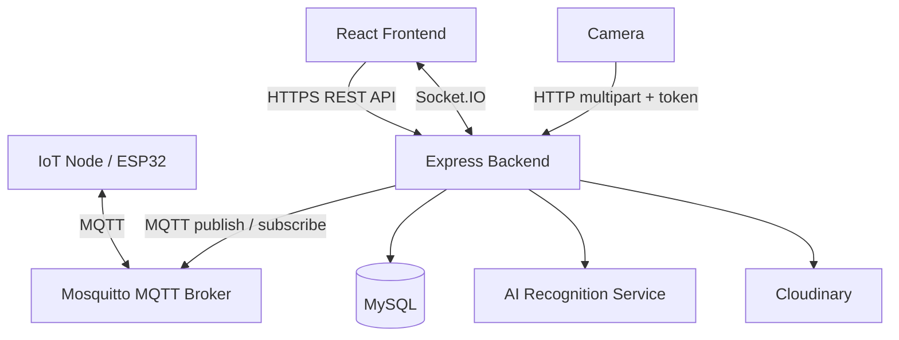
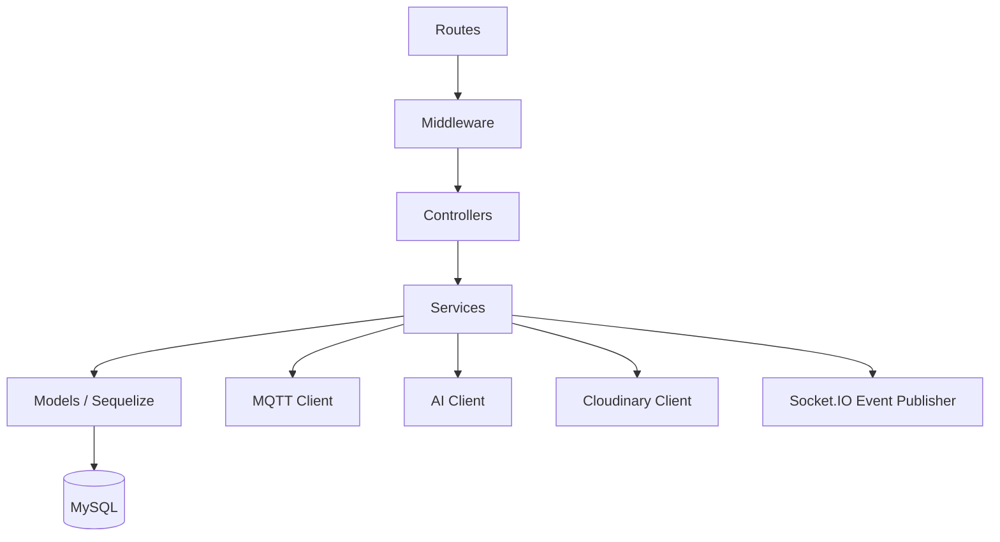
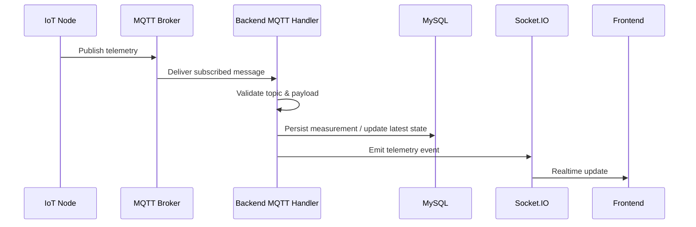
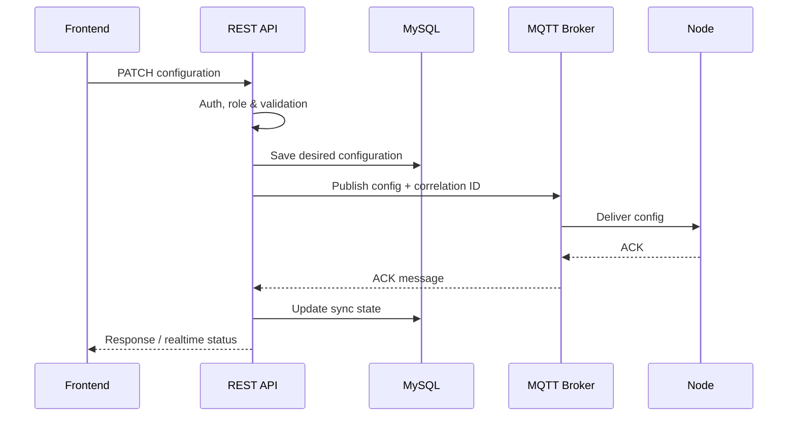
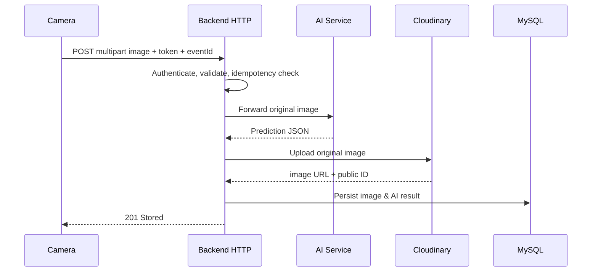
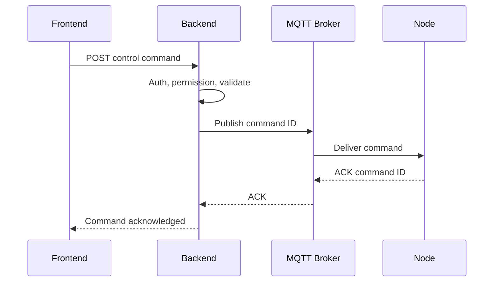

# Tài liệu thiết kế Server – Smart Agriculture IoT

> Phạm vi: thiết kế Backend/Server cho hệ thống IoT nông nghiệp thông minh. Tài liệu tập trung vào kiến trúc, các module, luồng dữ liệu, API, MQTT, lưu trữ và bảo mật. Không bao gồm firmware/embedded implementation và không bao gồm chức năng dự báo thời tiết.

## 1. Mục tiêu và phạm vi

Server chịu trách nhiệm:
- Quản lý tài khoản, xác thực và phân quyền.
- Quản lý Node/Device, trạng thái hoạt động và cấu hình thiết bị.
- Tiếp nhận telemetry từ thiết bị qua MQTT, cập nhật dữ liệu và trạng thái.
- Gửi lệnh điều khiển và cấu hình xuống thiết bị.
- Kiểm tra ngưỡng, phát cảnh báo khi dữ liệu vượt ngưỡng.
- Nhận ảnh từ Camera qua HTTP, chuyển ảnh đến dịch vụ AI, lưu ảnh gốc lên Cloudinary và lưu kết quả phân tích vào MySQL.
- Cung cấp REST API cho Frontend và realtime event qua Socket.IO.
- Lưu lịch sử hoạt động/audit để phục vụ truy vết.

Server không trực tiếp chạy thuật toán AI; AI là dịch vụ ngoài được Backend gọi. Server cũng không thực hiện dự báo thời tiết.

## 2. Kiến trúc tổng quan



### Thành phần

| Thành phần | Vai trò |
|---|---|
| Frontend | Dashboard, thiết bị, cấu hình, điều khiển, cảnh báo, lịch sử AI |
| Backend API | Xác thực, nghiệp vụ, REST endpoints, điều phối dữ liệu |
| MQTT Broker | Trung gian trao đổi message giữa Node và Backend |
| MQTT Client trong Backend | Subscribe telemetry/status/ACK và publish command/config |
| MySQL | Lưu tài khoản, node, thiết bị, cấu hình, telemetry, cảnh báo, phân tích AI, audit |
| AI Service | Nhận ảnh và trả về kết quả nhận diện bệnh/đặc trưng |
| Cloudinary | Lưu ảnh gốc Camera và cung cấp URL ảnh |
| Socket.IO | Đẩy cập nhật realtime tới Frontend |

## 3. Công nghệ dự kiến

- Node.js và Express: HTTP API.
- Sequelize: ORM và quản lý model/transaction.
- MySQL: dữ liệu quan hệ.
- MQTT.js: kết nối MQTT Broker.
- Mosquitto: broker MQTT (cấu hình tài khoản/ACL theo node khi môi trường hỗ trợ).
- Socket.IO: realtime events tới Frontend.
- JWT: xác thực request người dùng.
- bcrypt: hash mật khẩu và token bí mật khi lưu DB.
- Cloudinary SDK: upload ảnh Camera.

## 4. Backend layering



### Quy ước trách nhiệm

- **Routes:** khai báo URL, HTTP method và middleware; không chứa nghiệp vụ.
- **Middleware:** authentication, authorization, validation, upload limits, error handling.
- **Controllers:** nhận request, gọi service, trả HTTP response; không viết truy vấn nghiệp vụ dài.
- **Services:** xử lý nghiệp vụ và điều phối nhiều thành phần.
- **Models:** định nghĩa schema, quan hệ và thao tác DB.
- **Integrations:** MQTT, AI API, Cloudinary, Socket.IO được đóng gói thành adapter/service riêng.

## 5. Các module Backend

### 5.1 Auth & User
- Đăng nhập, tạo tài khoản (theo chính sách hệ thống), lấy thông tin tài khoản.
- Hash mật khẩu bằng bcrypt; không lưu mật khẩu dạng plaintext.
- JWT được kiểm tra ở middleware; token không chứa thông tin bí mật.
- Role dự kiến: `admin`, `operator`, `viewer`.
- `admin`: quản trị người dùng, node/device, provisioning và cấu hình.
- `operator`: xem dữ liệu, điều khiển thiết bị và chỉnh cấu hình được cấp phép.
- `viewer`: chỉ đọc dữ liệu.

### 5.2 Node & Device Management
- Tạo và quản lý Node, các thiết bị/cảm biến liên quan.
- Sinh mã định danh node/device duy nhất, không dựa vào `COUNT(*) + 1` để tránh trùng khi tạo đồng thời.
- Quản lý trạng thái vòng đời: `REGISTERED`, `ACTIVE`, `INACTIVE`/`OFFLINE` và các trạng thái bổ sung nếu được định nghĩa trong model hiện tại.
- Chỉ chuyển Node sang trạng thái hoạt động khi xác minh điều kiện kết nối/heartbeat hợp lệ.
- Lưu thời điểm heartbeat cuối, thông tin kết nối và trạng thái xác minh.

### 5.3 Device Configuration
- Lưu cấu hình ngưỡng và chế độ tự động.
- Ví dụ cấu hình quạt:

```json
{
  "fanThresholds": {
    "onTempC": 32,
    "offTempC": 30,
    "onHumidityPct": 85,
    "offHumidityPct": 80
  },
  "auto": {
    "enabled": true,
    "preset": "FAN_HYSTERESIS"
  }
}
```
- Validate dữ liệu ở Backend trước khi lưu/publish: kiểu dữ liệu, giới hạn nhiệt độ/độ ẩm, quan hệ ngưỡng bật/tắt.
- Cập nhật DB và publish cấu hình theo cơ chế có ACK hoặc timeout để UI có thể thể hiện trạng thái gửi/đồng bộ.
- Phân biệt cấu hình đã lưu ở Server và cấu hình thiết bị đã nhận: trạng thái đồng bộ nên được biểu diễn rõ ràng.

### 5.4 Telemetry & Device State
- Nhận telemetry qua MQTT.
- Validate topic, node identity, payload, timestamp và giá trị sensor.
- Lưu dữ liệu đo vào DB (hoặc cơ chế lưu phù hợp với tần suất dữ liệu).
- Cập nhật snapshot dữ liệu mới nhất và trạng thái thiết bị.
- Phát realtime event tới Frontend.
- Không tin cậy trực tiếp payload từ thiết bị: kiểm tra cấu trúc và giới hạn giá trị.

### 5.5 Command & Control
- Frontend yêu cầu điều khiển thông qua REST API.
- Backend kiểm tra JWT, role, node/device tồn tại và quyền truy cập.
- Backend tạo command ID, publish MQTT command và chờ ACK trong giới hạn timeout.
- Ghi lại kết quả command: pending, acknowledged, timeout, failed.
- Trả response cho Frontend; phát Socket.IO event khi command có kết quả.
- Không báo command thành công chỉ vì publish MQTT thành công; publish thành công và thiết bị thực thi thành công là hai trạng thái khác nhau.

### 5.6 Threshold Alerts
- Kiểm tra telemetry với cấu hình ngưỡng đã áp dụng.
- Có thể dùng hysteresis (ngưỡng bật và ngưỡng tắt riêng) để giảm việc trạng thái bật/tắt liên tục.
- Tạo alert khi điều kiện được kích hoạt; tránh tạo alert trùng lặp liên tục cho cùng một sự kiện.
- Lưu trạng thái alert, thời gian, node/device, giá trị đo và ngưỡng tham chiếu.
- Phát event realtime tới Frontend.

### 5.7 Camera & AI Analysis
- Camera gửi ảnh qua HTTP multipart kèm token xác thực.
- Backend xác thực Camera/token, giới hạn file, kiểm tra MIME thực tế, kích thước, event ID và chống xử lý trùng.
- Backend gửi buffer ảnh gốc đến AI service.
- Nhận kết quả AI (disease/class, confidence, predictions và metadata nếu có).
- Upload ảnh gốc Camera lên Cloudinary; không mặc định dùng ảnh do AI trả về.
- Lưu URL ảnh, Cloudinary public ID, checksum ảnh, kết quả AI, thời gian xử lý và các metadata vào MySQL.
- Frontend lấy lịch sử phân tích qua API và hiển thị ảnh + kết quả.
- Token Camera chỉ hiển thị một lần khi tạo; DB lưu hash token.

Luồng xử lý nên hỗ trợ trạng thái để retry khi lỗi giữa các bước:

`PROCESSING → AI_COMPLETED → UPLOAD_PENDING → COMPLETED`

Các lỗi có thể chuyển `FAILED` (kèm lý do và khả năng retry). Không đánh dấu hoàn tất trước khi DB ghi nhận kết quả thành công.

### 5.8 MQTT Provisioning & Security
- Mỗi Node có credential MQTT riêng nếu broker hỗ trợ.
- Tài khoản/ACL giới hạn Node chỉ được publish/subscribe topic được phép.
- Backend tạo credential và ACL trong quá trình đăng ký Node theo cơ chế provisioning đã chọn.
- Không log password/token; chỉ lưu hash các secret cần đối chiếu.
- Broker credentials, API keys và JWT secret được cấp bằng environment variables.

### 5.9 Audit Log
Ghi các hành động quan trọng, ví dụ:
- Đăng nhập và thay đổi tài khoản/quyền.
- Tạo/xóa Node, Camera hoặc Device.
- Thay đổi cấu hình ngưỡng.
- Lệnh điều khiển thiết bị.
- Provisioning/rotate credential.
- Kết quả xử lý Camera/AI khi cần truy vết.

Audit record nên gồm actor, action, resource, thời gian, kết quả và metadata an toàn; không ghi token, password hay API secret.
## 6. Luồng dữ liệu chính

### 6.1 Telemetry từ Node



### 6.2 Cập nhật cấu hình



Nếu ACK bị timeout, Server giữ trạng thái chưa xác nhận và không được giả định Node đã áp dụng cấu hình.

### 6.3 Camera gửi ảnh và nhận kết quả AI



### 6.4 Điều khiển thiết bị



## 7. MQTT topic và payload conventions

> Topic/payload bên dưới là quy ước thiết kế tham khảo. Khi triển khai, phải đối chiếu với topic constants và firmware hiện tại để tránh thay đổi giao thức ngoài ý muốn.

| Topic pattern | Hướng | Mục đích |
|---|---|---|
| `telemetry/<nodeCode>` | Node → Backend | Sensor data |
| `heartbeat/<nodeCode>` | Node → Backend | Heartbeat / online evidence |
| `status/<nodeCode>` | Node → Backend | Trạng thái node/device |
| `config/<nodeCode>` | Backend → Node | Cấu hình |
| `config/ack/<nodeCode>` | Node → Backend | ACK cấu hình |
| `command/<nodeCode>` | Backend → Node | Lệnh điều khiển |
| `command/ack/<nodeCode>` | Node → Backend | ACK command |

Payload nên có `nodeCode`, `messageId`/`commandId` (khi cần), `timestamp`, `type` và data. Backend cần xác thực `nodeCode` trong topic trùng với node trong payload nếu payload có node identity.

## 8. REST API boundaries

> Bảng này mô tả nhóm API ở mức thiết kế, không phải cam kết mọi endpoint đã tồn tại đúng tên trong code.

| Nhóm | Ví dụ endpoint | Chức năng |
|---|---|---|
| Auth | `POST /api/auth/login` | Đăng nhập |
| User | `GET /api/users/me` | Thông tin user hiện tại |
| Node | `GET/POST /api/nodes` | Danh sách/tạo Node |
| Node | `GET/PATCH/DELETE /api/nodes/:id` | Chi tiết/cập nhật/xóa Node |
| Device | `GET /api/devices` | Danh sách thiết bị |
| Device | `GET /api/devices/:id` | Chi tiết thiết bị |
| Configuration | `PATCH /api/devices/:id/config` | Cập nhật ngưỡng/chế độ |
| Control | `POST /api/devices/:id/commands` | Gửi lệnh điều khiển |
| Telemetry | `GET /api/nodes/:id/telemetry` | Lịch sử dữ liệu đo |
| Alerts | `GET /api/alerts` | Danh sách cảnh báo |
| Alerts | `PATCH /api/alerts/:id` | Cập nhật trạng thái alert |
| Camera | `POST /api/camera/tokens/:cameraId` | Cấp token Camera (admin) |
| Camera | `POST /api/camera/media` | Camera upload ảnh và kích hoạt AI |
| AI history | `GET /api/ai/analyses` | Lịch sử phân tích |
| Audit | `GET /api/audit-logs` | Tra cứu log (quyền phù hợp) |

## 9. Database responsibilities

Các nhóm bảng chính (tên thực tế phụ thuộc model hiện tại):

- Users / UserRoles: tài khoản và phân quyền.
- Nodes: định danh, trạng thái, heartbeat, provisioning metadata.
- Devices: loại thiết bị, node liên kết, trạng thái.
- DeviceConfigurations: desired config, revision, trạng thái đồng bộ.
- Telemetry: dữ liệu sensor theo thời gian.
- Alerts: cảnh báo và trạng thái xử lý.
- CameraTokens: hash token, Camera liên kết, trạng thái/revocation metadata.
- LeafAnalyses: event ID, image URL, Cloudinary public ID, checksum, kết quả AI, confidence, predictions, timestamps, processing status.
- AuditLogs: hành động quan trọng và actor.

Quan hệ và tên cột phải được đồng bộ với Sequelize models/migrations; tài liệu này không thay thế schema thực tế.
## 10. Security

- HTTPS cho API và TLS cho kết nối dịch vụ khi môi trường hỗ trợ.
- JWT secret, MQTT credentials, AI API key và Cloudinary secret chỉ lưu ở Backend environment.
- Hash password bằng bcrypt; Camera token lưu hash.
- RBAC kiểm tra tại Backend, không chỉ ẩn nút trên Frontend.
- MQTT ACL giới hạn theo Node/topic.
- Validate request body, query, topic và MQTT payload.
- Upload: giới hạn dung lượng, MIME allowlist, kiểm tra nội dung file, timeout; tránh tin filename do client gửi.
- Chống replay/idempotency cho Camera event và command nếu phù hợp.
- Rate limit endpoint đăng nhập, provisioning và upload.
- Log có kiểm soát, không chứa credential hay token.
- CORS chỉ cho origin Frontend hợp lệ.
## 11. Reliability & failure handling

| Tình huống | Hướng xử lý |
|---|---|
| MQTT broker mất kết nối | Reconnect/backoff; trạng thái connection; không coi Node online khi không có heartbeat hợp lệ |
| Node offline | Dựa trên heartbeat timeout; cập nhật status và phát realtime event |
| Config không ACK | Timeout, đánh dấu pending/failed-to-confirm; cho phép retry; correlation ID |
| Command không ACK | Ghi timeout; không khẳng định thiết bị đã thực thi |
| Telemetry sai format | Reject/ignore có log; không làm crash MQTT handler |
| AI service lỗi | Lưu trạng thái failed và lỗi an toàn; retry theo chính sách |
| Cloudinary lỗi | Không đánh dấu analysis completed; giữ khả năng retry upload |
| DB lỗi | Không trả success nếu dữ liệu bắt buộc chưa được persist; xử lý reconnect/health status |
| Camera gửi event trùng | Idempotency theo Camera/event ID; trả kết quả duplicate nếu event đã hoàn tất |
| Socket.IO client disconnect | REST vẫn là nguồn dữ liệu chính; client tải lại qua API khi reconnect |

## 12. Observability

- Health endpoint kiểm tra Backend và dependency theo mức phù hợp.
- Log có timestamp, request ID/correlation ID, module, action và outcome.
- Theo dõi MQTT connection/reconnect, message validation failures, ACK timeout, Camera upload/AI failures.
- Không expose stack trace, credential hoặc cấu hình nội bộ ra API response.
- Có thể bổ sung metrics: request latency, telemetry rate, command success/timeout, AI processing duration.
## 13. Deployment architecture

Môi trường triển khai dự kiến:
- Frontend: Vercel.
- Backend: Render hoặc nền tảng Node hosting phù hợp.
- MySQL: managed MySQL-compatible service.
- MQTT Broker: broker cloud hỗ trợ MQTT và ACL phù hợp với cơ chế provisioning của Backend.
- Image storage: Cloudinary.

Lưu ý: Backend free-tier có thể sleep hoặc giới hạn tài nguyên. Một dịch vụ sleep không phù hợp cho xử lý MQTT liên tục/near-real-time; cần chọn hosting đảm bảo worker chạy liên tục nếu hệ thống yêu cầu uptime. Broker cloud phải hỗ trợ đúng tính năng auth/ACL mà Backend sử dụng; thay Mosquitto bằng broker khác có thể cần sửa provisioning module.
## 14. Environment configuration

Các biến môi trường điển hình (tên chính xác cần khớp `env` config trong source):

```env
NODE_ENV=production
PORT=3000
CORS_ORIGIN=https://your-frontend.example
JWT_SECRET=replace-with-strong-secret

DB_HOST=
DB_PORT=3306
DB_NAME=
DB_USER=
DB_PASSWORD=
DB_SSL=true

MQTT_URL=mqtts://your-broker-host:8883
MQTT_USERNAME=
MQTT_PASSWORD=

AI_API_URL=
AI_API_KEY=

CLOUDINARY_CLOUD_NAME=
CLOUDINARY_API_KEY=
CLOUDINARY_API_SECRET=
CLOUDINARY_FOLDER=smart-agri/camera-media
```

## 15. Các quyết định thiết kế cần chốt

- MQTT topic và payload schema cuối cùng phải khớp firmware.
- Cơ chế ACK cho config và command: timeout, retry, correlation ID.
- Quy tắc offline dựa trên heartbeat interval/timeout.
- Telemetry retention: lưu tất cả hay chỉ lưu theo chu kỳ/giới hạn thời gian.
- Camera event idempotency và retry policy khi AI/Cloudinary/MySQL lỗi.
- Quyền admin/operator/viewer cho từng API.
- Broker cloud có hỗ trợ provisioning API/ACL tương thích hay cần adapter riêng.
- Các endpoint và tên bảng chính xác phải được đối chiếu với code Backend hiện hành.
## 16. Kết luận

Backend đóng vai trò trung tâm điều phối giữa Frontend, Node IoT, MQTT Broker, AI service, Cloudinary và MySQL. REST API phục vụ thao tác có chủ đích từ người dùng; MQTT phục vụ dữ liệu và lệnh thiết bị; Socket.IO cung cấp cập nhật realtime. Mọi thao tác cần được xác thực, phân quyền, kiểm tra dữ liệu, ghi nhận trạng thái và xử lý lỗi có thể retry. MySQL là nguồn dữ liệu lưu trữ chính; Frontend không tự quyết định trạng thái thiết bị hay kết quả xử lý command.
